# Settings

## Using the administrator interface 

All settings for the application are controlled via the Settings menu at
the top of the Site Administration page.

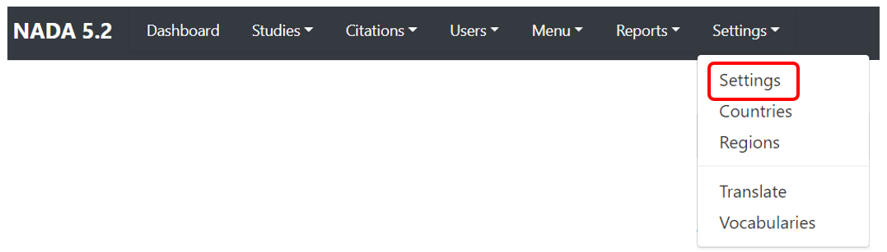

There are seven main settings sections.

> 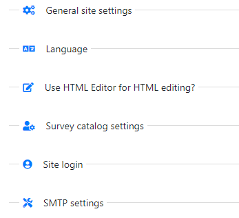

## General site settings

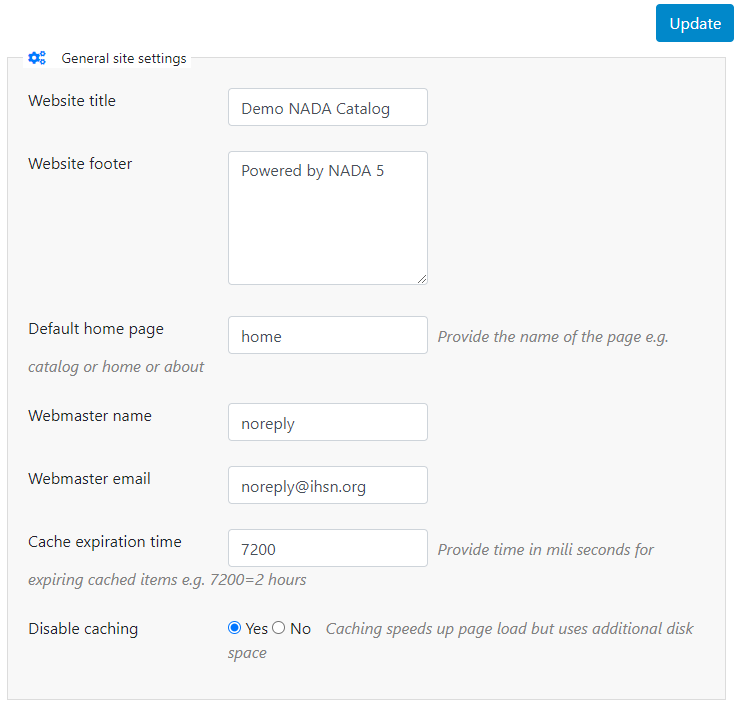

The **Website title** will become the frontpage title of the NADA
catalog. In the user interface:

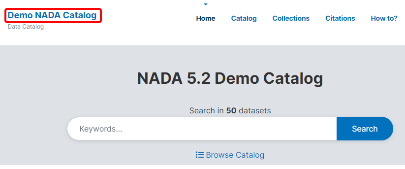

**Website footer**: The footer text can be changed in this field. This
displays at the bottom of your site page when your theme outputs it (see
[Customizing themes](/installation-guide/configurations/customizing-themes)).

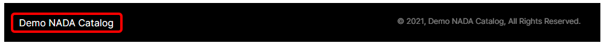

**Default home page**: The initial page that loads when a user visits
the NADA site can be set here. In this case the catalog page is set to
open by default. For a full guide (menus, static views, and the default
`home.php` template), see [Customizing the home page](/admin-guide/web-ui/customizing-home-page).

**Webmaster name**: The name of the webmaster can be set here. This is
the name that will be used in system emails sent to users.

**Webmaster email**: Enter the webmaster email address here. This should
be the address that will be used in communication with users. Typically,
this is a general enquiries email set up by the organization and not a
personal email address for a particular person. Note: to avoid mail
systems rejecting mail as spam make sure to enter an address here that
is on the same domain as the server used in the email settings at setup.

**Cache expiration time**: A cache folder stores pre- generated pages of
the site to allow for faster browsing by the user. Set the time that the
Cache takes to expire. By default, it is set to 2 hours (in
milliseconds).

**Disable caching**: If it is desired to turn off caching then select
"no" here. Sometimes it is useful to turn off caching when developing or
updating a site to ensure that content changes become immediately
visible on the front-end without having to wait for the cache to expire
and the new changes to show. Turn this back on to speed up page loading
for users.

Click **Update** to save all settings.

## Language

To change the language of the application, expand the language section
and choose the desired language. Click **Update** to save and apply the
setting.

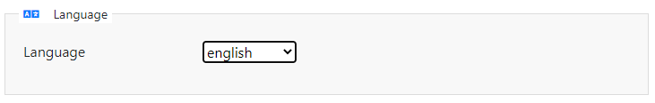

The change of language will apply to both the user and the administrator
interfaces.

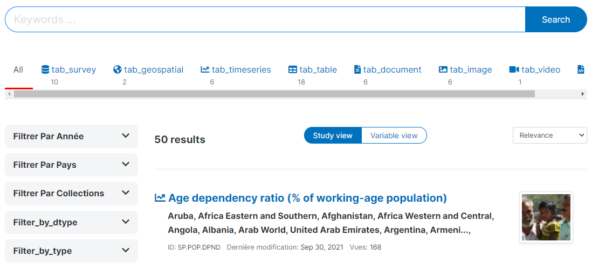

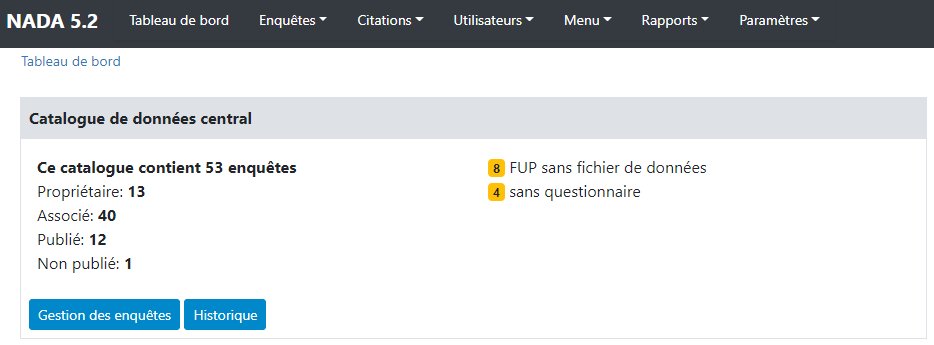

If you see content that is not in the selected language, it means that
some translations are missing. If a translation is missing, or if you
think that the translation is not accurate, you can add/edit the
translation yourself. See the section "Translating NADA".

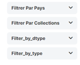

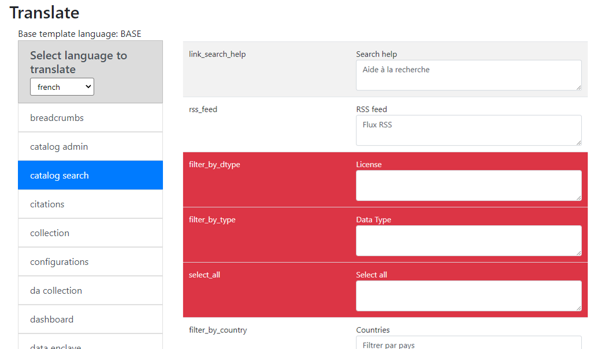

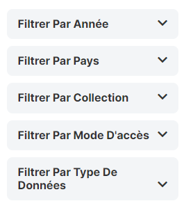

## Use of HTML Editor

A basic HTML editor is provided in the menu and page creating section of
the application. This setting allows this to be turned on or off.

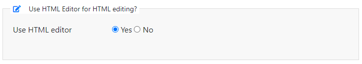

## Survey catalog settings

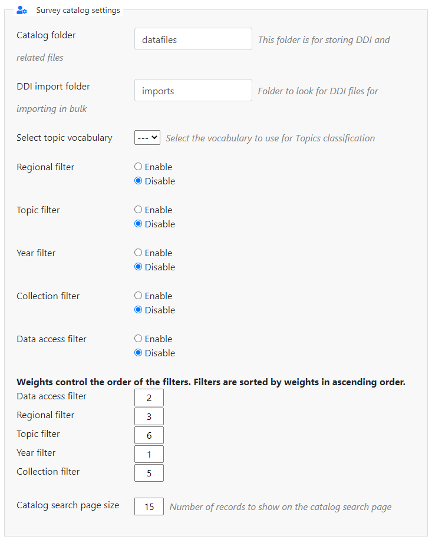

**Catalog folder**: This is the folder where the files for the study are
stored on the server. This includes the DDI, eternal resources and data
files. This folder can be moved to a location outside the web root as
described in the installation instructions in Chapter 1. Enter either
relative or absolute paths to the folder location.

**DDI import folder**: This is the folder where DDI's can be placed in
order to use the bulk study import function in the NADA. In NADA3 files
had to be physically copied to this folder on the server, but this is no
longer necessary in NADA 4. Files can now be directly uploaded to this
folder from the Site Administration -- Manage Studies page page.

-   Select the vocabulary to use for the topic filter. By default, this
    is set to the CESSDA classification as recommended in the IHSN
    templates supplied at IHSN.org for the Nesstar Metadata Publisher.

-   Enable or disable the Country filter on the user interface search
    page here. If the catalog only contains studies for one country,
    then turning this filter off is recommended.

-   Enable or disable the Topic filter on the user interface search page
    here. If no topics have been defined in the DDI's being uploaded,
    then it is recommended to turn this filter off (disable).

-   Enable or disable the Year filter on the user interface search page
    here.

-   Enable or disable the Collection filter on the user interface search
    page here. If no collections have been defined, then it is
    recommended to disable this filter.

-   Enable or disable the Data access filter on the user interface
    search page here. This filter is not needed if there are very few
    studies in the catalog or if all studies are set to the same access
    type.

-   This section controls the order in which the filters appear on the
    search page. Enter numbers here that rank the order of the filters
    in the order they should be displayed.

**Catalog search page size**: This setting determines how many studies
are displayed by default to the user on the search page -- catalog view.

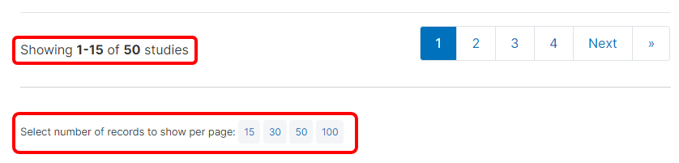

## Site login

**Password protected website:** By default, a NADA catalog created on a
web server will be accessible to all users with access to the URL
(intranet or internet). Users will only need to register and login when
they want to request access, or access, non-public data. In some cases,
however, a catalog administrator may want to restrict the access to the
catalog to authorized persons only. This can be done by requiring that
all users login to access the website, by selecting the option "Requires
all users to login to access the website". *\[how do they get a
password?\]*

**Login timeout**: determines how long a user will stay logged in. After
the time indicated here (a positive value in minutes), the user will be
automatically logged out.

**Minimum password length**: Sets the minimum length for passwords
created by the users at registration, or for manual user creation by
administrators. The use of strong passwords is recommended.

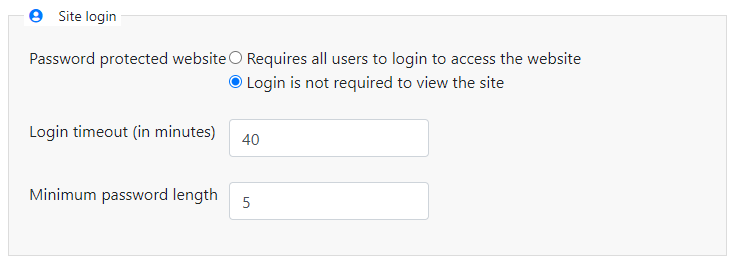

## Search

The **Search** section chooses how the public catalog search runs. It has one panel per engine; the radio button on
a panel's header selects that engine.

| Engine | Meaning |
|--------|---------|
| **Database (built-in)** | The catalog database searches studies, variables and citations. Default; nothing to install |
| **Solr** | Full-text search with Apache Solr. Variables are still searched in the database. See [Solr search](./solr) |
| **NADA-AI** | Semantic and multilingual search with NADA-AI, which runs next to NADA. See [NADA-AI search](./nada-ai) |

Below the panels, **Index kept in sync** names the engine whose index NADA keeps up to date: **None**, **Solr** or
**NADA-AI**. NADA then records every study and citation change for that engine.

The search engine must be **Database** or the engine selected in **Index kept in sync**. This lets you build an index
while the database still serves searches, then switch:

1. Set **Index kept in sync** to the new engine and click **Update**.
2. Build the index (see [Solr search](./solr) or [NADA-AI search](./nada-ai)).
3. Select the engine's panel and click **Update**.

The top of the section shows the engine in use and the index kept in sync, as saved.

The **NADA-AI** panel also holds NADA-AI's connection (**NADA-AI API URL**, **NADA-AI API Key**), what to do while
it is unavailable, the **Multilingual search** switch, and a debug switch. They are explained in
[NADA-AI search](./nada-ai#_2-connect-nada).

## SMTP settings

NADA may need to be able to send emails to users. This will be the case
when access to some datasets (public use files, or licensed access
datasets) require that users be registered. Email communications will be
used by NADA to (i) confirm and activate the user registration, and (ii)
to inform users of the status of their requests for access to licensed
datasets. To allow this, an email account dedicated to NADA must be
created (possibly on a commercial email application like G-mail), and
the SMTP must be configured to enable this account.

The SMTP settings are set by editing the config/email.php file (which
cannot be done using the administrator interface). Once done, it is
essential to test the email settings. This can be done using the "Test
email configurations" button.

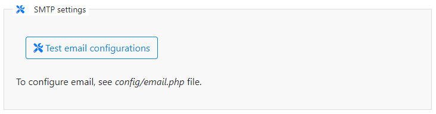

Another way to test if the email settings are working is to use the
"forgot password" option from the user login page. If no mail is
received when doing this test, the mail settings must be corrected. If
necessary, check with the ISP or server administrator for the correct
settings.

## Using the API 

The site settings cannot be changed using the API.